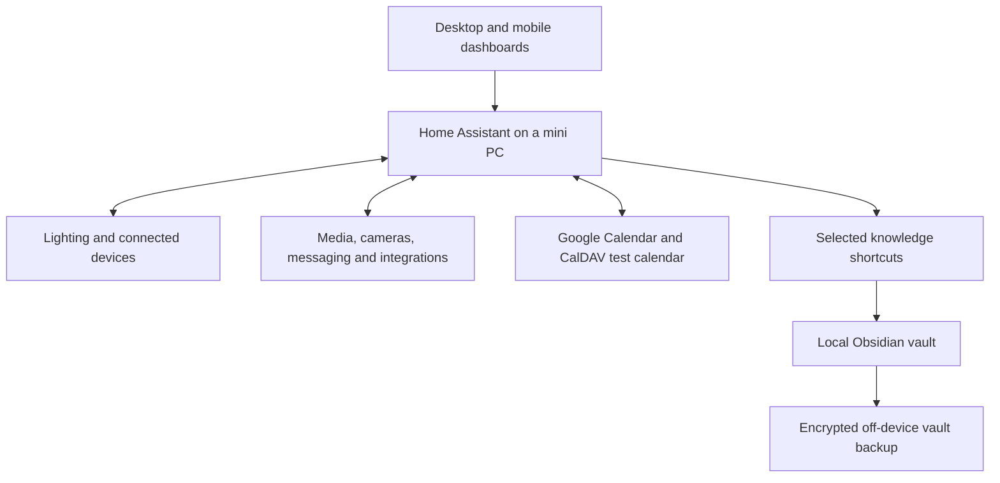

  <a href="docs/features.md">Feature tour</a> ·
  <a href="docs/architecture.md">Architecture & decisions</a> ·
  <a href="docs/roadmap.md">What's next</a> ·
  <a href="https://github.com/rjyates">About me</a>

# A homelab built around everyday life

My personal environment for exploring **systems integration, automation, self-hosting, and thoughtful interface design**. The goal is a home and personal computing system that reduces effort, makes information easier to use, and stays understandable.

Home Assistant is the hub. Around it are connected devices, specialized services, a local Obsidian knowledge system, and ongoing experiments. **Vera is the in-development local AI assistant envisioned to complement this environment**, with curated knowledge access and human approval for consequential actions.

This repository is a **public documentation showcase**, not a deployable copy of my private environment. It explains the work and its design decisions without publishing live configuration, personal records, network details, or camera imagery.

## Explore the work

| Area | What it brings together |
| :--- | :--- |
| **Home dashboard** | Catppuccin styling, Bubble cards, responsive desktop/mobile layouts, room controls, and navigation to focused pages. |
| **Lighting & routines** | Presence-aware lighting, sunset and scheduled behavior, room/device controls, wind-down scenes, and manual overrides. |
| **Planner** | Calendar events, tasks, flexible recurring chores, and a compact daily preview. |
| **Self-hosted calendar** | A custom frontend backed by Radicale/CalDAV, deployed as a Home Assistant local app and connected to the Planner in test mode. |
| **Media & cameras** | Living-room music/TV controls, camera views, and existing event-notification workflows. |
| **Personal information** | Focused email, financial administration, career/learning, and wearable-summary interfaces. Only the feature design is documented here. |
| **Knowledge & recovery** | Selected Obsidian shortcuts, technical documentation, and an encrypted off-device vault backup with an initial verified restore. |
| **Operations & access** | A System Health dashboard, private remote connectivity, service administration, and local voice components. |

**[Read the feature tour →](docs/features.md)**

## System at a glance

The diagram summarizes responsibilities, not network topology. Obsidian shortcuts open selected notes; they do not give Home Assistant general access to the vault. The backup is a separate workflow.

## Engineering questions I care about

- How should services share information without turning one application into a universal database?
- How can automation remain predictable when people also use manual controls?
- How can a dashboard feel consistent across devices without showing everything at once?
- How do prototypes become dependable services through validation, persistence checks, and recovery planning?
- How could AI propose useful actions while trusted software validates and executes them?

My approach favors **clear boundaries, practical controls, small changes, and evidence over assumptions**. Local-first is a preference, not a claim that every integration works offline; several features depend on external services.

## Vera: the next assistance layer

Vera's intended role is to help retrieve information, prepare administrative work, support planning, and eventually interact with Home Assistant. It is **not yet a fully integrated local assistant**, and dedicated inference hardware has not been built or finalized.

An existing Codex worker and Home Assistant MCP integration are separate tooling. Their presence does not mean Vera is deployed, has unrestricted access, or can act autonomously across the system.

**[Current boundaries and future work →](docs/roadmap.md)**

## Scope and status

Documentation assembled **October 22, 2026**, from existing technical records and recently verified work. This is a dated project overview, not a live availability report or an assertion that every configured integration is healthy.

No private dashboard exports, secrets, personal schedules, account data, or device inventories are included. Planned hardware is deliberately separate from the current mini-PC/Surface setup. Technical implementation lives in its appropriate private projects rather than being copied into this showcase.
